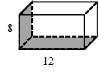
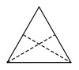

# AVP0716 — Single visual target

We-Math:265 / We-Math:776 · different type · Geometric markers

## Shared or similar visual information

A straight line made of separated strokes.

## Evidence locations

- Left image: The dashed rear bottom edge bordering the shaded base.
- Right image: The dashed segment from the left base vertex to the opposite sloping side.

## Mathematical meanings

Left image: It represents an occluded lower edge of the box. Right image: It marks a crease for folding the triangle.

## Same mathematical meanings

no

## Rationales

The left dashes trace a concealed boundary of a solid. The right stroke lies in a visible construction or subdivision. It marks a crease for folding the triangle.

Only the selected target is annotated. AI visual-review draft; not independently double-annotated by humans.
