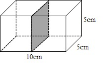
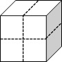

# AVP0717 — Single visual target

We-Math:84 / We-Math:86 · same type · Geometric markers

## Shared or similar visual information

A straight line made of separated strokes.

## Evidence locations

- Left image: The dashed horizontal segment along the lower back edge of the outer box.
- Right image: The dashed vertical line across the front face of the cube.

## Mathematical meanings

Left image: It represents the occluded rear bottom edge of the full box. Right image: It marks a subdivision across the visible cube face.

## Same mathematical meanings

no

## Rationales

The left dashes trace a concealed boundary of a solid. The right stroke lies in a visible construction or subdivision. It marks a subdivision across the visible cube face.

Only the selected target is annotated. AI visual-review draft; not independently double-annotated by humans.
