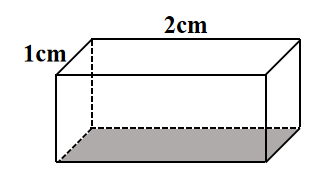
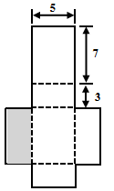

# AVP0718 — Single visual target

We-Math:267 / We-Math:1009 · same type · Geometric markers

## Shared or similar visual information

A straight line made of separated strokes.

## Evidence locations

- Left image: The dashed line along the rear side of the shaded bottom face.
- Right image: The horizontal dashed seam immediately below the top rectangle of the cuboid net.

## Mathematical meanings

Left image: It represents an occluded lower edge of the cuboid. Right image: It separates neighboring face panels in the unfolded net.

## Same mathematical meanings

no

## Rationales

The left dashes trace a concealed boundary of a solid. The right stroke lies in a visible construction or subdivision. It separates neighboring face panels in the unfolded net.

Only the selected target is annotated. AI visual-review draft; not independently double-annotated by humans.
