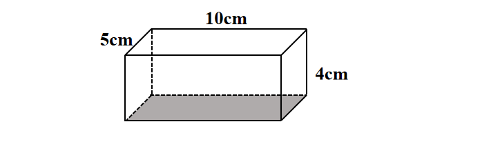
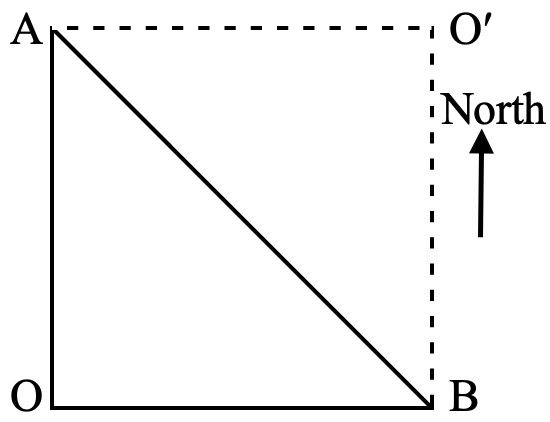

# AVP0719 — Single visual target

We-Math:623 / We-Math:1734 · different type · Geometric markers

## Shared or similar visual information

A straight line made of separated strokes.

## Evidence locations

- Left image: The dashed segment along the far side of the gray bottom face.
- Right image: The dashed horizontal and vertical sides meeting at the upper-right corner.

## Mathematical meanings

Left image: It represents the hidden rear bottom edge of the cuboid. Right image: They complete a planar reference square around the solid diagonal.

## Same mathematical meanings

no

## Rationales

The left dashes trace a concealed boundary of a solid. The right stroke lies in a visible construction or subdivision. They complete a planar reference square around the solid diagonal.

Only the selected target is annotated. AI visual-review draft; not independently double-annotated by humans.
