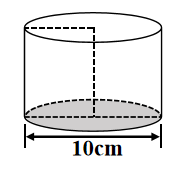

# AVP0720 — Single visual target

We-Math:366 / MathVerse:568 · different type · Geometric markers

## Shared or similar visual information

A broken stroke used for a line or curve in the diagram.

## Evidence locations

- Left image: The dashed rear arc of the lower ellipse above the shaded base.
- Right image: The magenta dashed parabola labeled g.

## Mathematical meanings

Left image: It represents the obscured portion of the cylinder base circumference. Right image: It is the plotted graph of g.

## Same mathematical meanings

no

## Rationales

The left stroke derives its role from the geometric construction. It represents the obscured portion of the cylinder base circumference. The right stroke is interpreted from the coordinate plot. It is the plotted graph of g.

Only the selected target is annotated. AI visual-review draft; not independently double-annotated by humans.
