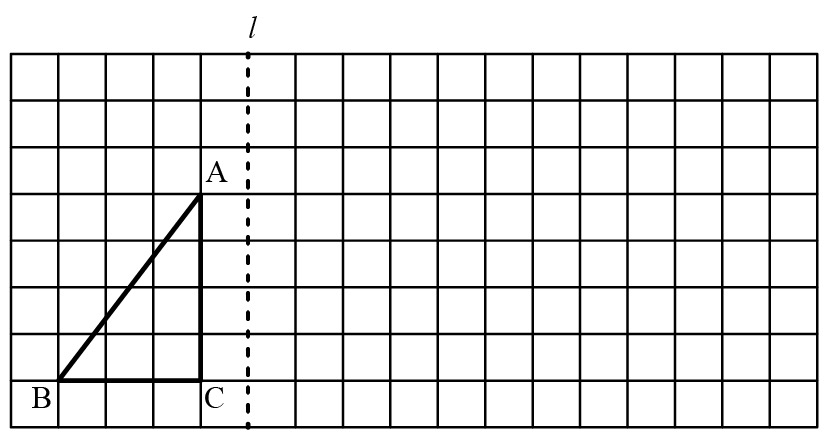
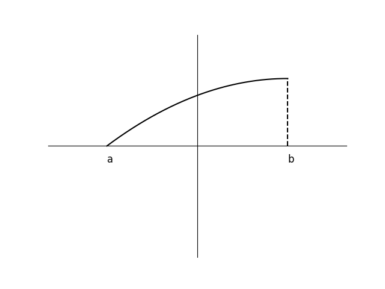

# AVP0722 — Single visual target

We-Math:392 / DynaMath:204 · different type · Geometric markers

## Shared or similar visual information

A broken stroke used for a line or curve in the diagram.

## Evidence locations

- Left image: The dotted vertical line labeled l beside the triangle in the square lattice.
- Right image: The dashed vertical stroke at b, dropping from the end of the curve to the horizontal axis.

## Mathematical meanings

Left image: It marks the mirror line for reflecting the triangle. Right image: It projects the curve endpoint to its horizontal coordinate b.

## Same mathematical meanings

no

## Rationales

The left stroke derives its role from the geometric construction. It marks the mirror line for reflecting the triangle. The right stroke is interpreted from the coordinate plot. It projects the curve endpoint to its horizontal coordinate b.

Only the selected target is annotated. AI visual-review draft; not independently double-annotated by humans.
