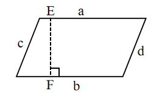

# AVP0723 — Single visual target

We-Math:497 / MathVerse:535 · different type · Geometric markers

## Shared or similar visual information

A broken stroke used for a line or curve in the diagram.

## Evidence locations

- Left image: The dashed line EF connecting the horizontal sides of the parallelogram.
- Right image: The horizontal magenta dashed line through the curve at height 1.2.

## Mathematical meanings

Left image: It constructs the perpendicular separation between the parallel sides. Right image: It marks a fixed ordinate used to locate a graph point.

## Same mathematical meanings

no

## Rationales

The left stroke derives its role from the geometric construction. It constructs the perpendicular separation between the parallel sides. The right stroke is interpreted from the coordinate plot. It marks a fixed ordinate used to locate a graph point.

Only the selected target is annotated. AI visual-review draft; not independently double-annotated by humans.
