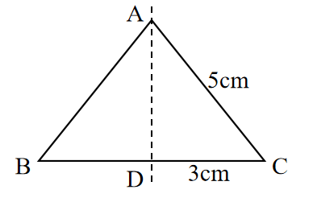
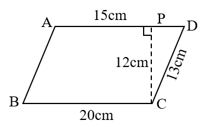

# AVP0724 — Single visual target

We-Math:115 / We-Math:1532 · same type · Geometric markers

## Shared or similar visual information

A vertical dashed segment crossing or reaching a figure base.

## Evidence locations

- Left image: The vertical dashed line passing through A and D.
- Right image: The vertical dashed segment PC meeting AD at a square.

## Mathematical meanings

Left image: It marks the reflection axis of the symmetric triangle. Right image: It constructs the perpendicular distance from C to AD.

## Same mathematical meanings

no

## Rationales

The left dashes locate the line about which the figure reflects. The right dashes join an off-center vertex to a marked perpendicular foot, giving an altitude construction.

Only the selected target is annotated. AI visual-review draft; not independently double-annotated by humans.
