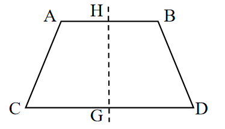
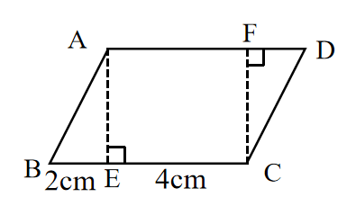

# AVP0725 — Single visual target

We-Math:117 / We-Math:223 · same type · Geometric markers

## Shared or similar visual information

A vertical dashed segment crossing or reaching a figure base.

## Evidence locations

- Left image: The dashed vertical line crossing the two bases at H and G.
- Right image: The left dashed segment AE ending at the square on BC.

## Mathematical meanings

Left image: It marks the reflection axis of the symmetric trapezoid. Right image: It constructs the perpendicular separation from A to BC.

## Same mathematical meanings

no

## Rationales

The left dashes locate the line about which the figure reflects. The right dashes join an off-center vertex to a marked perpendicular foot, giving an altitude construction.

Only the selected target is annotated. AI visual-review draft; not independently double-annotated by humans.
