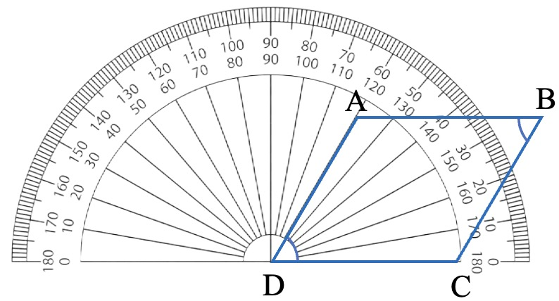
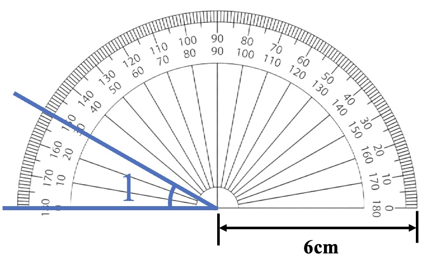

# AVP0727 — Single visual target

We-Math:348 / We-Math:349 · same type · Geometric markers

## Shared or similar visual information

Short ticks repeated along the curved rim of a protractor.

## Evidence locations

- Left image: The closely spaced short ticks along the upper-left protractor rim.
- Right image: A short graduation near the upper-left edge of the protractor behind the blue ray.

## Mathematical meanings

Left image: They mark angle-reading increments on the protractor scale. Right image: It gives an angular reading position on the protractor scale.

## Same mathematical meanings

yes

## Rationales

Both sets of radial graduations divide an angular scale. Their positions on a protractor rim let the reader measure the direction of a ray relative to the baseline.

Only the selected target is annotated. AI visual-review draft; not independently double-annotated by humans.
