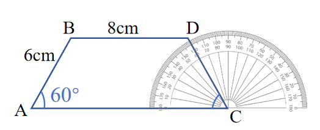
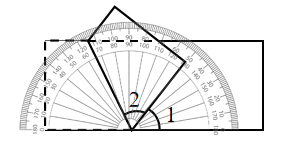

# AVP0730 — Single visual target

We-Math:354 / We-Math:1147 · same type · Geometric markers

## Shared or similar visual information

Short ticks repeated along the curved rim of a protractor.

## Evidence locations

- Left image: A short graduation along the protractor rim behind the blue segment DC.
- Right image: A short tick on the gray semicircular rim behind the tilted polygon.

## Mathematical meanings

Left image: It gives an angular reading position about C. Right image: It marks a degree reading on the protractor scale.

## Same mathematical meanings

yes

## Rationales

Both sets of radial graduations divide an angular scale. Their positions on a protractor rim let the reader measure the direction of a ray relative to the baseline.

Only the selected target is annotated. AI visual-review draft; not independently double-annotated by humans.
