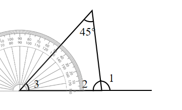
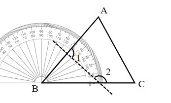

# AVP0731 — Single visual target

We-Math:1141 / We-Math:1142 · same type · Geometric markers

## Shared or similar visual information

Short ticks repeated along the curved rim of a protractor.

## Evidence locations

- Left image: A short graduation on the upper arc of the gray protractor at the left vertex.
- Right image: A short tick on the graduated arc around B.

## Mathematical meanings

Left image: It marks a degree reading on the protractor scale. Right image: It marks an angular reading position about B.

## Same mathematical meanings

yes

## Rationales

Both sets of radial graduations divide an angular scale. Their positions on a protractor rim let the reader measure the direction of a ray relative to the baseline.

Only the selected target is annotated. AI visual-review draft; not independently double-annotated by humans.
