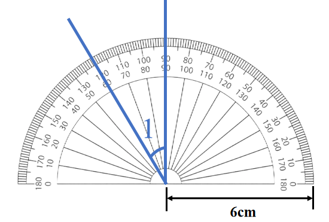
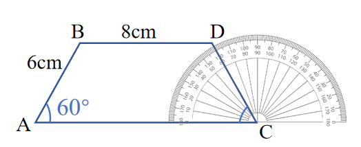

# AVP0732 — Single visual target

We-Math:347 / We-Math:354 · same type · Geometric markers

## Shared or similar visual information

Short ticks repeated along the curved rim of a protractor.

## Evidence locations

- Left image: A short tick along the gray semicircular rim near the top of the protractor.
- Right image: A short graduation along the protractor rim behind the blue segment DC.

## Mathematical meanings

Left image: It divides the protractor scale into angular reading positions. Right image: It gives an angular reading position about C.

## Same mathematical meanings

yes

## Rationales

Both sets of radial graduations divide an angular scale. Their positions on a protractor rim let the reader measure the direction of a ray relative to the baseline.

Only the selected target is annotated. AI visual-review draft; not independently double-annotated by humans.
