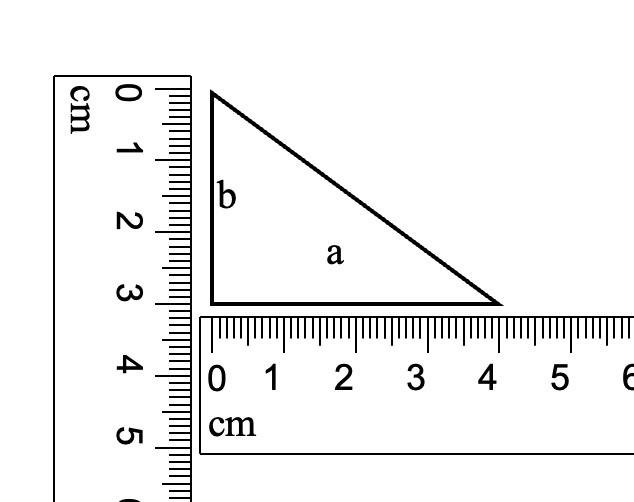
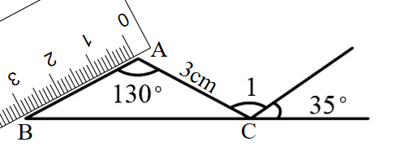

# AVP0736 — Single visual target

We-Math:1055 / We-Math:1633 · same type · Geometric markers

## Shared or similar visual information

Short repeated graduations along a straight ruler edge.

## Evidence locations

- Left image: A short graduation along the horizontal ruler directly beneath the triangle base.
- Right image: A short graduation on the slanted ruler aligned with BA.

## Mathematical meanings

Left image: It marks a position on the ruler’s linear centimeter scale. Right image: It marks a linear reading position on a physical length scale.

## Same mathematical meanings

yes

## Rationales

The evenly spaced short marks give linear reading positions along the ruler edge in both images. Ruler orientation does not alter the measured quantity.

Only the selected target is annotated. AI visual-review draft; not independently double-annotated by humans.
