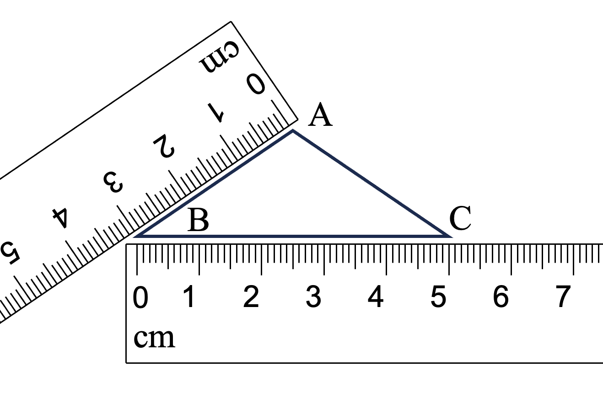
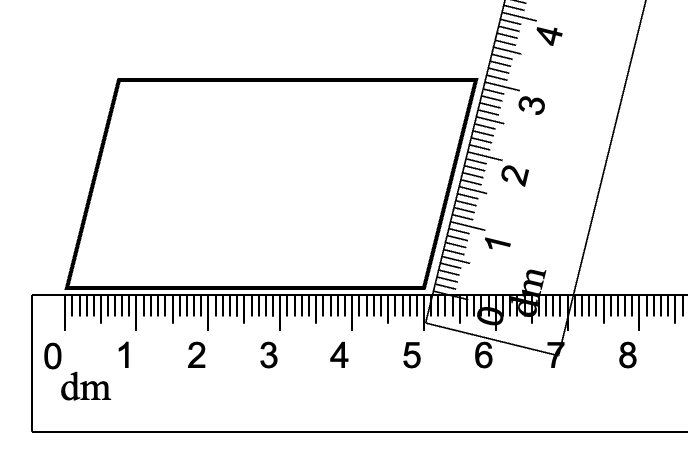

# AVP0737 — Single visual target

We-Math:1057 / We-Math:1054 · same type · Geometric markers

## Shared or similar visual information

Short repeated graduations along a straight ruler edge.

## Evidence locations

- Left image: A short graduation on the lower horizontal ruler beneath BC.
- Right image: A short graduation on the horizontal ruler under the parallelogram.

## Mathematical meanings

Left image: It marks a linear reading position on the ruler, which is labeled in centimeters. Right image: It marks a linear reading position on the scale labeled in decimeters.

## Same mathematical meanings

yes

## Rationales

The evenly spaced short marks give linear reading positions along the ruler edge in both images. Ruler orientation does not alter the measured quantity.

Only the selected target is annotated. AI visual-review draft; not independently double-annotated by humans.
