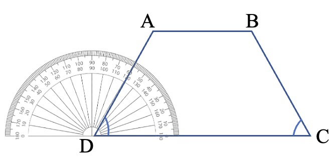
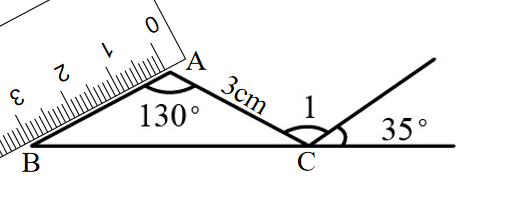

# AVP0743 — Single visual target

We-Math:352 / We-Math:1633 · same type · Geometric markers

## Shared or similar visual information

A series of closely spaced short graduations on a measuring edge.

## Evidence locations

- Left image: A short radial graduation near the top of the gray protractor at D.
- Right image: A short graduation on the slanted ruler aligned with BA.

## Mathematical meanings

Left image: It gives an angular reading position about D. Right image: It marks a linear reading position on a physical length scale.

## Same mathematical meanings

no

## Rationales

The graduations on the curved protractor edge represent angular increments about a center. The graduations on the straight ruler edge represent linear distance along the ruler.

Only the selected target is annotated. AI visual-review draft; not independently double-annotated by humans.
