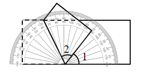
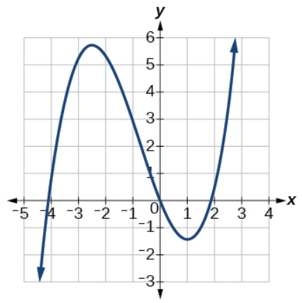

# AVP0747 — Single visual target

We-Math:1147 / MathVerse:488 · different type · Geometric markers

## Shared or similar visual information

A short scale-reading stroke beside other regularly spaced ticks.

## Evidence locations

- Left image: A short tick on the gray semicircular rim behind the tilted polygon.
- Right image: A short vertical stroke on the positive x-axis beneath the rising curve.

## Mathematical meanings

Left image: It marks a degree reading on the protractor scale. Right image: It marks a numeric input coordinate on the graph axis.

## Same mathematical meanings

no

## Rationales

The left strokes are degree graduations on a protractor. The right stroke is attached to a Cartesian plot axis and indicates a graph coordinate.

Only the selected target is annotated. AI visual-review draft; not independently double-annotated by humans.
