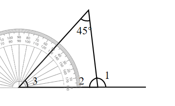
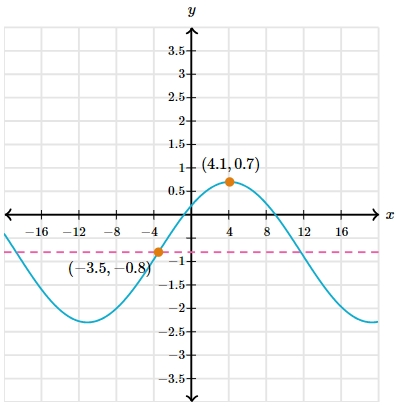

# AVP0748 — Single visual target

We-Math:1141 / MathVerse:533 · different type · Geometric markers

## Shared or similar visual information

A short scale-reading stroke beside other regularly spaced ticks.

## Evidence locations

- Left image: A short graduation on the upper arc of the gray protractor at the left vertex.
- Right image: The short vertical tick above the x-axis label 4.

## Mathematical meanings

Left image: It marks a degree reading on the protractor scale. Right image: It marks the horizontal coordinate 4.

## Same mathematical meanings

no

## Rationales

The left strokes are degree graduations on a protractor. The right stroke is attached to a Cartesian plot axis and indicates a graph coordinate.

Only the selected target is annotated. AI visual-review draft; not independently double-annotated by humans.
