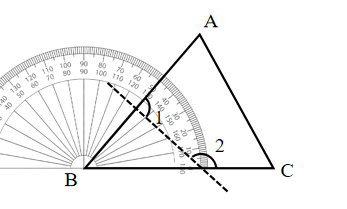

# AVP0749 — Single visual target

We-Math:1142 / MathVerse:546 · different type · Geometric markers

## Shared or similar visual information

A short scale-reading stroke beside other regularly spaced ticks.

## Evidence locations

- Left image: A short tick on the graduated arc around B.
- Right image: A short vertical tick on the horizontal axis labeled t.

## Mathematical meanings

Left image: It marks an angular reading position about B. Right image: It marks a position of the independent coordinate t.

## Same mathematical meanings

no

## Rationales

The left strokes are degree graduations on a protractor. The right stroke is attached to a Cartesian plot axis and indicates a graph coordinate.

Only the selected target is annotated. AI visual-review draft; not independently double-annotated by humans.
