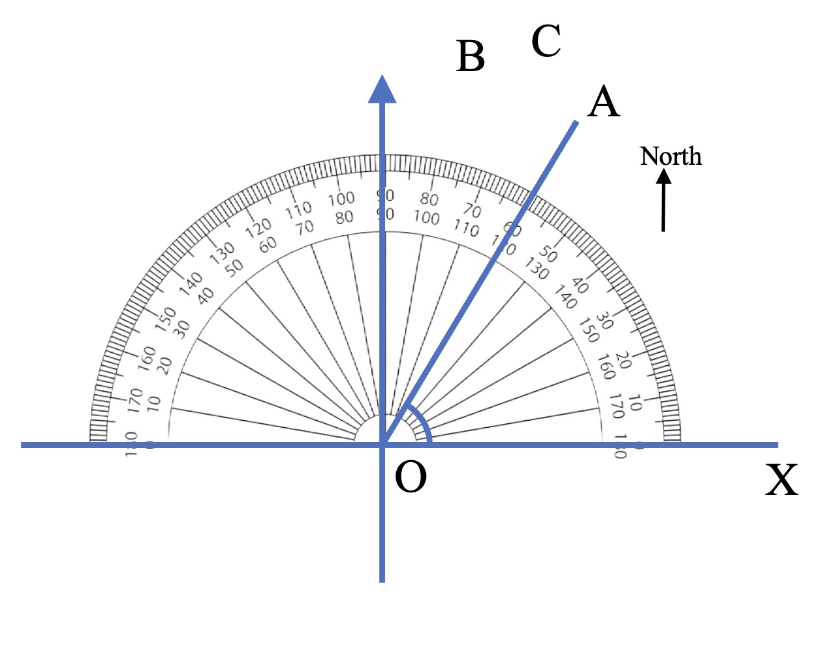

# AVP0750 — Single visual target

We-Math:353 / MathVerse:535 · different type · Geometric markers

## Shared or similar visual information

A short scale-reading stroke beside other regularly spaced ticks.

## Evidence locations

- Left image: A small tick along the curved top rim of the protractor above O.
- Right image: A short vertical tick on the x-axis near the origin.

## Mathematical meanings

Left image: It gives an angular reading position about the center O. Right image: It marks a horizontal coordinate reading position on the plot.

## Same mathematical meanings

no

## Rationales

The left strokes are degree graduations on a protractor. The right stroke is attached to a Cartesian plot axis and indicates a graph coordinate.

Only the selected target is annotated. AI visual-review draft; not independently double-annotated by humans.
