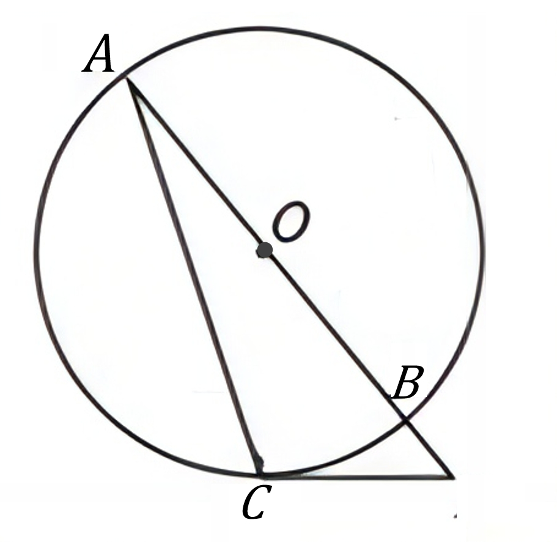
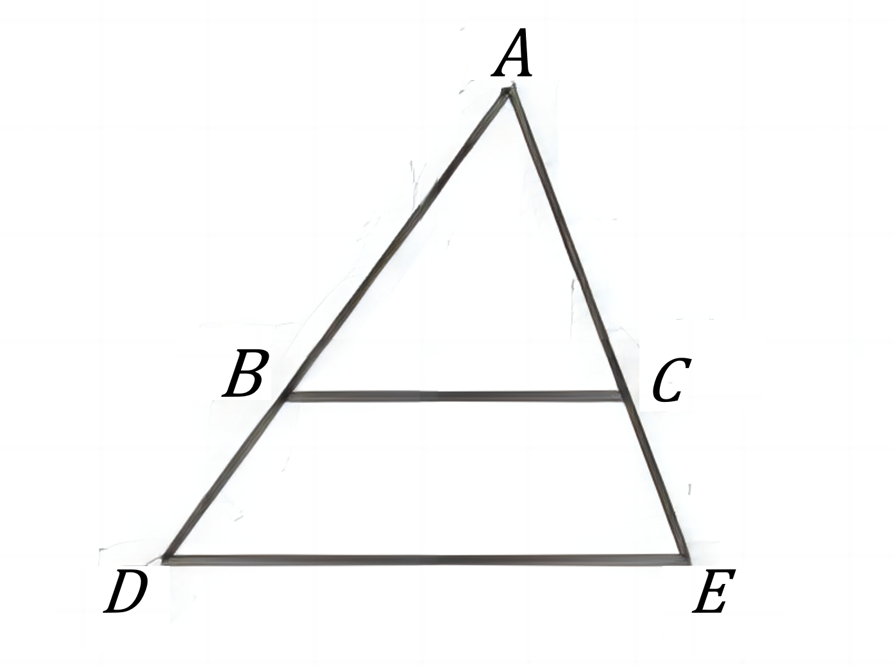

# AVP0756 — Single visual target

DynaMath:81 / DynaMath:200 · same type · Mathematical roles of symbols

## Shared or similar visual information

The letter A

## Evidence locations

- Left image: A at the upper endpoint of the line through O
- Right image: A at the apex above the two horizontal segments

## Mathematical meanings

Left image: The symbol "A" names a specific geometric point at the indicated location. Right image: The symbol "A" names a specific geometric point at the indicated location.

## Same mathematical meanings

yes

## Rationales

The left occurrence is A at the upper endpoint of the line through O. The right occurrence is A at the apex above the two horizontal segments. The placement in each image shows that the symbol names a specific geometric point at the indicated location.

Only the selected target is annotated. AI visual-review draft; not independently double-annotated by humans.
