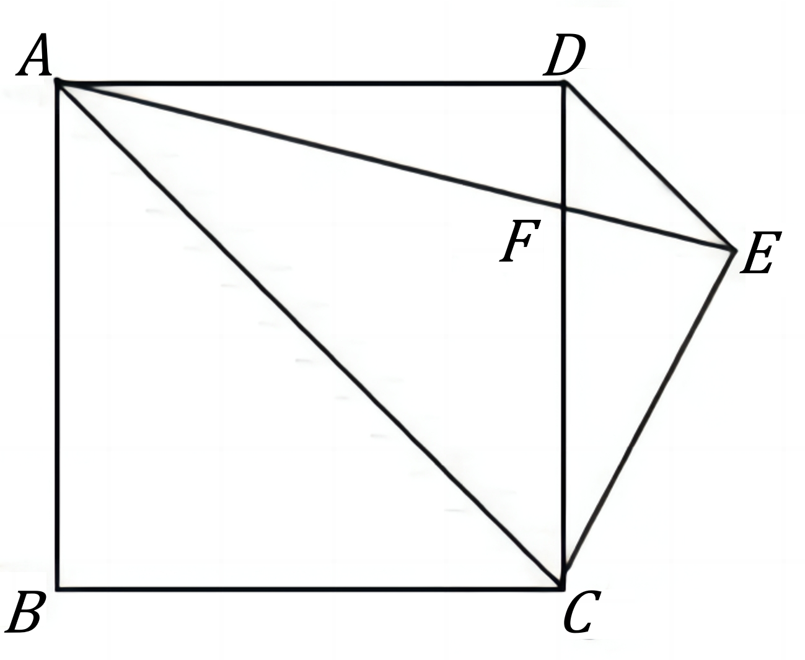
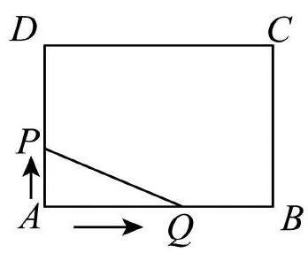

# AVP0758 — Single visual target

DynaMath:167 / MV-MATH:635_1 · same type · Mathematical roles of symbols

## Shared or similar visual information

The letter A

## Evidence locations

- Left image: A at the common endpoint of the three slanted segments
- Right image: A below the lower-left corner of rectangle ABCD

## Mathematical meanings

Left image: The symbol "A" names a specific geometric point at the indicated location. Right image: The symbol "A" names a specific geometric point at the indicated location.

## Same mathematical meanings

yes

## Rationales

The left occurrence is A at the common endpoint of the three slanted segments. The right occurrence is A below the lower-left corner of rectangle ABCD. The placement in each image shows that the symbol names a specific geometric point at the indicated location.

Only the selected target is annotated. AI visual-review draft; not independently double-annotated by humans.
