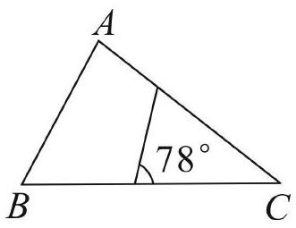
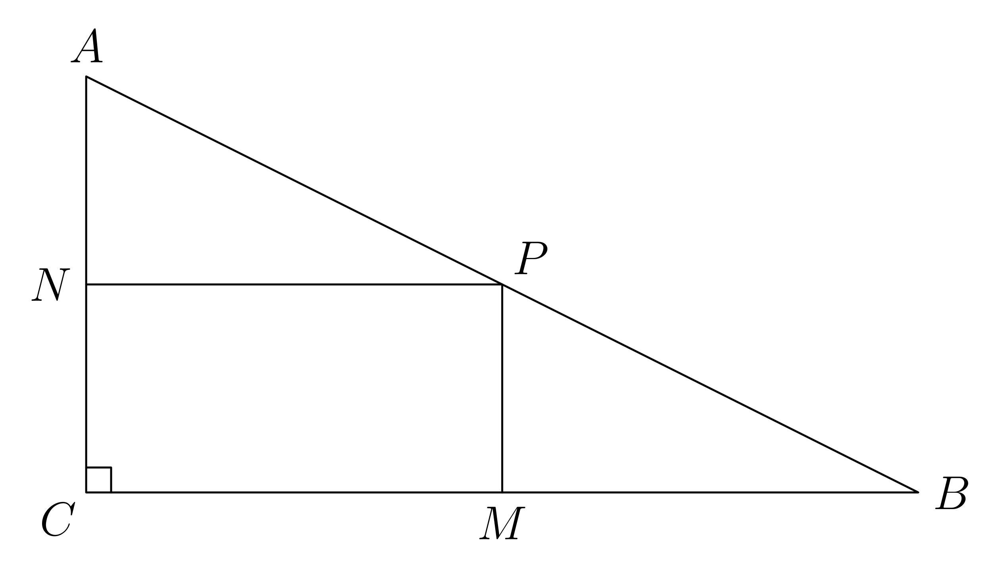

# AVP0759 — Single visual target

MV-MATH:526_1 / DynaMath:178 · same type · Mathematical roles of symbols

## Shared or similar visual information

The letter A

## Evidence locations

- Left image: A just above the apex of triangle ABC
- Right image: A at the upper end of the vertical side

## Mathematical meanings

Left image: The symbol "A" names a specific geometric point at the indicated location. Right image: The symbol "A" names a specific geometric point at the indicated location.

## Same mathematical meanings

yes

## Rationales

The left occurrence is A just above the apex of triangle ABC. The right occurrence is A at the upper end of the vertical side. The placement in each image shows that the symbol names a specific geometric point at the indicated location.

Only the selected target is annotated. AI visual-review draft; not independently double-annotated by humans.
