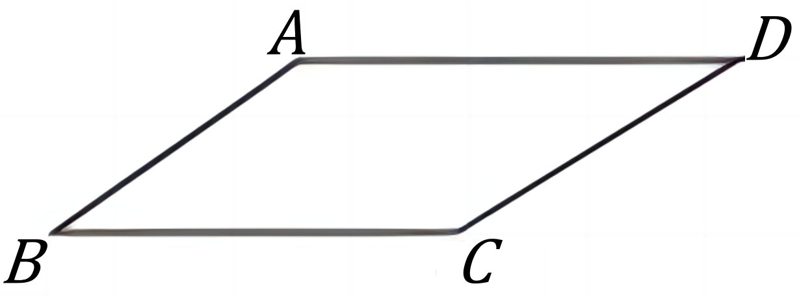
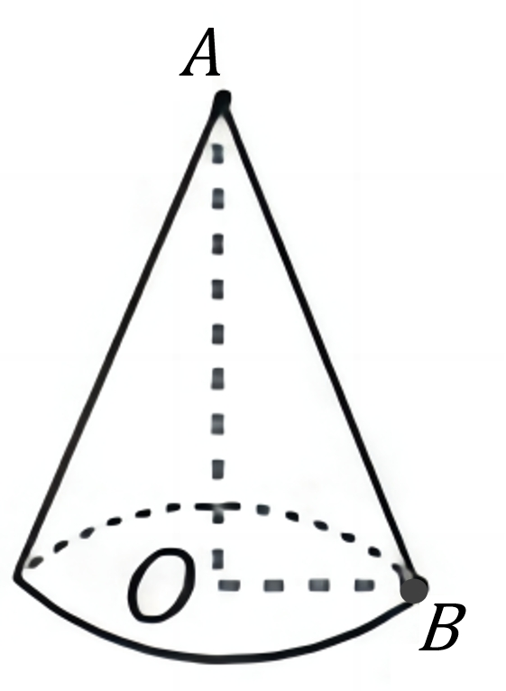

# AVP0763 — Single visual target

DynaMath:49 / DynaMath:8 · different type · Mathematical roles of symbols

## Shared or similar visual information

The letter B

## Evidence locations

- Left image: B at the lower-left parallelogram corner
- Right image: B at the marked point on the cone's base rim

## Mathematical meanings

Left image: The symbol "B" names a specific geometric point at the indicated location. Right image: The symbol "B" names a specific geometric point at the indicated location.

## Same mathematical meanings

yes

## Rationales

The left occurrence is B at the lower-left parallelogram corner. The right occurrence is B at the marked point on the cone's base rim. The placement in each image shows that the symbol names a specific geometric point at the indicated location.

Only the selected target is annotated. AI visual-review draft; not independently double-annotated by humans.
