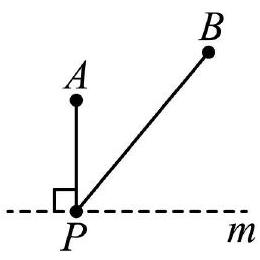
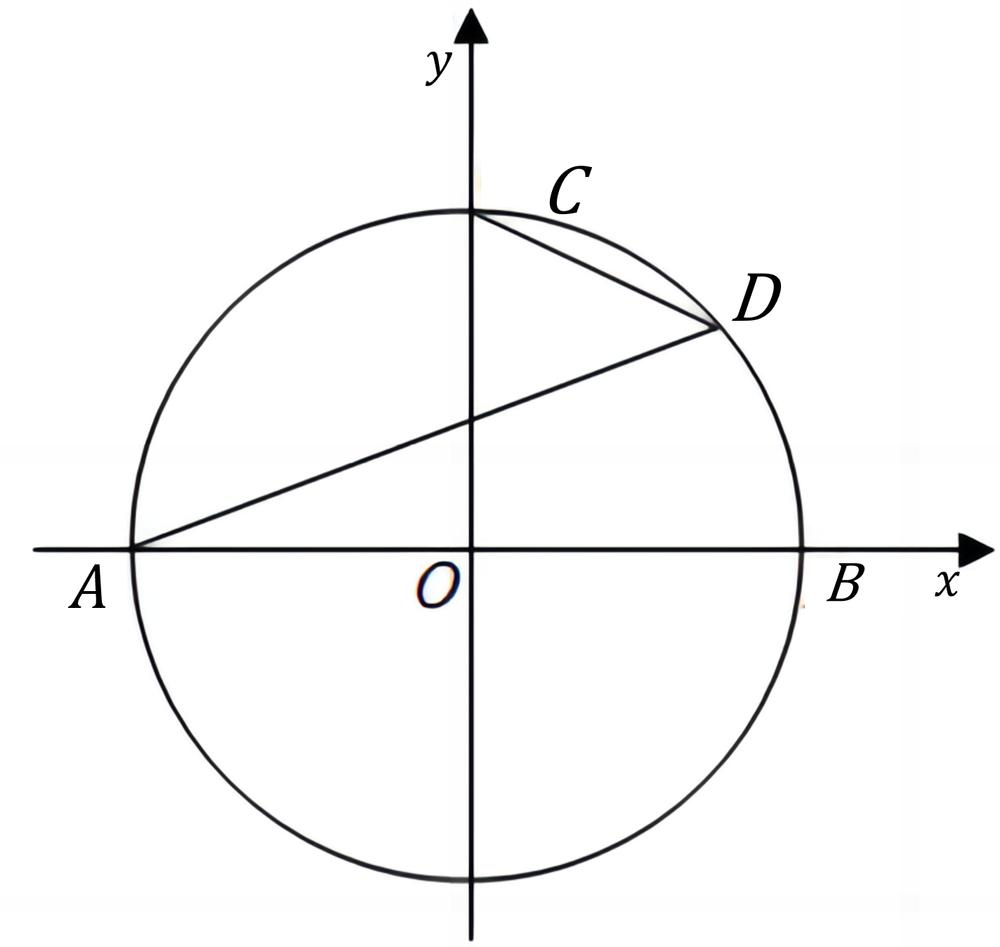

# AVP0764 — Single visual target

MV-MATH:1056_1 / DynaMath:55 · same type · Mathematical roles of symbols

## Shared or similar visual information

The letter B

## Evidence locations

- Left image: B at the upper-right black endpoint of the slanted segment
- Right image: B at the right intersection of the circle and horizontal axis

## Mathematical meanings

Left image: The symbol "B" names a specific geometric point at the indicated location. Right image: The symbol "B" names a specific geometric point at the indicated location.

## Same mathematical meanings

yes

## Rationales

The left occurrence is B at the upper-right black endpoint of the slanted segment. The right occurrence is B at the right intersection of the circle and horizontal axis. The placement in each image shows that the symbol names a specific geometric point at the indicated location.

Only the selected target is annotated. AI visual-review draft; not independently double-annotated by humans.
