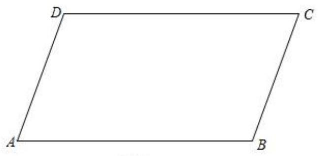
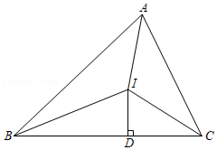

# AVP0765 — Single visual target

MV-MATH:1933_1 / DynaMath:13 · same type · Mathematical roles of symbols

## Shared or similar visual information

The letter C

## Evidence locations

- Left image: C at the upper-right vertex of the parallelogram
- Right image: C at the right endpoint of the base

## Mathematical meanings

Left image: The symbol "C" names a specific geometric point at the indicated location. Right image: The symbol "C" names a specific geometric point at the indicated location.

## Same mathematical meanings

yes

## Rationales

The left occurrence is C at the upper-right vertex of the parallelogram. The right occurrence is C at the right endpoint of the base. The placement in each image shows that the symbol names a specific geometric point at the indicated location.

Only the selected target is annotated. AI visual-review draft; not independently double-annotated by humans.
