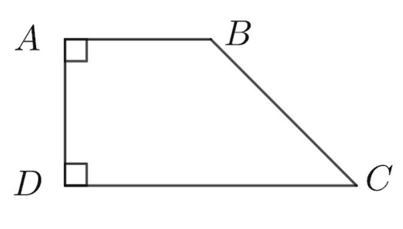
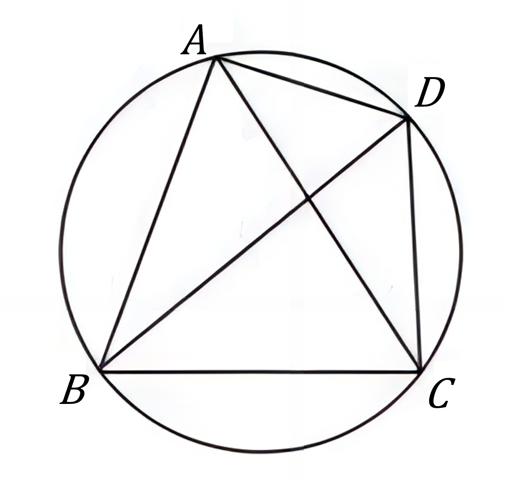

# AVP0767 — Single visual target

DynaMath:62 / DynaMath:32 · same type · Mathematical roles of symbols

## Shared or similar visual information

The letter C

## Evidence locations

- Left image: C at the lower-right endpoint of the slanted side
- Right image: C at the lower-right vertex on the circle

## Mathematical meanings

Left image: The symbol "C" names a specific geometric point at the indicated location. Right image: The symbol "C" names a specific geometric point at the indicated location.

## Same mathematical meanings

yes

## Rationales

The left occurrence is C at the lower-right endpoint of the slanted side. The right occurrence is C at the lower-right vertex on the circle. The placement in each image shows that the symbol names a specific geometric point at the indicated location.

Only the selected target is annotated. AI visual-review draft; not independently double-annotated by humans.
