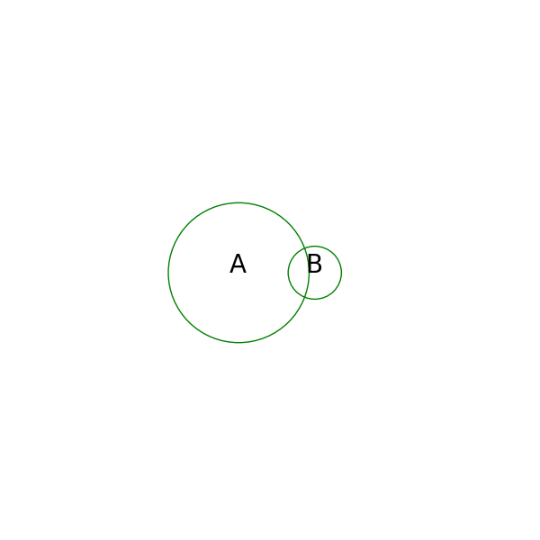
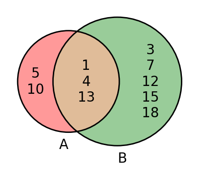

# AVP0770 — Single visual target

DynaMath:121 / DynaMath:468 · same type · Mathematical roles of symbols

## Shared or similar visual information

The letter A

## Evidence locations

- Left image: A centered inside the larger green set circle
- Right image: A below the left circle listing elements 5 and 10 in its exclusive region

## Mathematical meanings

Left image: The symbol "A" names the set represented by the indicated circle. Right image: The symbol "A" names the set represented by the indicated circle.

## Same mathematical meanings

yes

## Rationales

The left occurrence is A centered inside the larger green set circle. The right occurrence is A below the left circle listing elements 5 and 10 in its exclusive region. The placement in each image shows that the symbol names the set represented by the indicated circle.

Only the selected target is annotated. AI visual-review draft; not independently double-annotated by humans.
