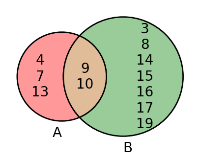
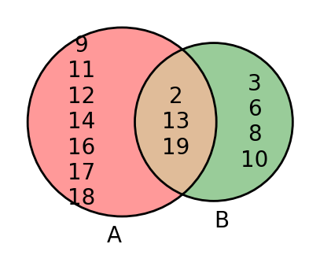

# AVP0771 — Single visual target

DynaMath:473 / DynaMath:469 · same type · Mathematical roles of symbols

## Shared or similar visual information

The letter A

## Evidence locations

- Left image: A below the red circle with 4, 8 and 13 on its left-only side
- Right image: A below the left circle with 9 at its upper edge

## Mathematical meanings

Left image: The symbol "A" names the set represented by the indicated circle. Right image: The symbol "A" names the set represented by the indicated circle.

## Same mathematical meanings

yes

## Rationales

The left occurrence is A below the red circle with 4, 8 and 13 on its left-only side. The right occurrence is A below the left circle with 9 at its upper edge. The placement in each image shows that the symbol names the set represented by the indicated circle.

Only the selected target is annotated. AI visual-review draft; not independently double-annotated by humans.
