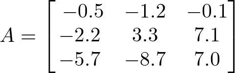
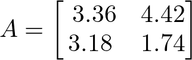

# AVP0772 — Single visual target

DynaMath:474 / DynaMath:481 · same type · Mathematical roles of symbols

## Shared or similar visual information

The letter A

## Evidence locations

- Left image: A before the equals sign and the 3 by 3 array beginning with -0.5
- Right image: A before the 2 by 2 array beginning with 3.36

## Mathematical meanings

Left image: The symbol "A" names the matrix whose entries follow in brackets. Right image: The symbol "A" names the matrix whose entries follow in brackets.

## Same mathematical meanings

yes

## Rationales

The left occurrence is A before the equals sign and the 3 by 3 array beginning with -0.5. The right occurrence is A before the 2 by 2 array beginning with 3.36. The placement in each image shows that the symbol names the matrix whose entries follow in brackets.

Only the selected target is annotated. AI visual-review draft; not independently double-annotated by humans.
