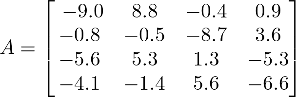
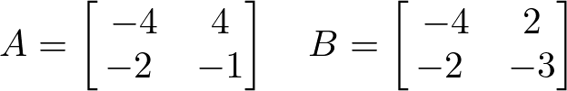

# AVP0773 — Single visual target

DynaMath:477 / DynaMath:475 · same type · Mathematical roles of symbols

## Shared or similar visual information

The letter A

## Evidence locations

- Left image: A before the 4 by 4 array beginning with -9.0
- Right image: A before the first of two bracketed matrices

## Mathematical meanings

Left image: The symbol "A" names the matrix whose entries follow in brackets. Right image: The symbol "A" names the matrix whose entries follow in brackets.

## Same mathematical meanings

yes

## Rationales

The left occurrence is A before the 4 by 4 array beginning with -9.0. The right occurrence is A before the first of two bracketed matrices. The placement in each image shows that the symbol names the matrix whose entries follow in brackets.

Only the selected target is annotated. AI visual-review draft; not independently double-annotated by humans.
