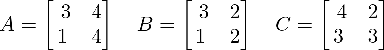
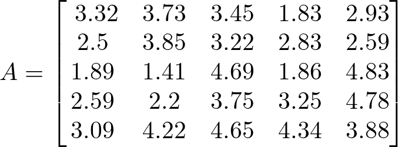

# AVP0774 — Single visual target

DynaMath:478 / DynaMath:484 · same type · Mathematical roles of symbols

## Shared or similar visual information

The letter A

## Evidence locations

- Left image: A before the first of three arrays, whose first row is 3, 4
- Right image: A before the 5 by 5 array beginning with 3.32

## Mathematical meanings

Left image: The symbol "A" names the matrix whose entries follow in brackets. Right image: The symbol "A" names the matrix whose entries follow in brackets.

## Same mathematical meanings

yes

## Rationales

The left occurrence is A before the first of three arrays, whose first row is 3, 4. The right occurrence is A before the 5 by 5 array beginning with 3.32. The placement in each image shows that the symbol names the matrix whose entries follow in brackets.

Only the selected target is annotated. AI visual-review draft; not independently double-annotated by humans.
