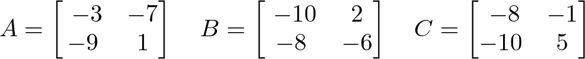
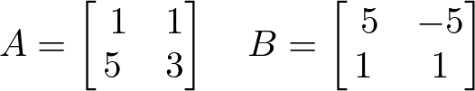

# AVP0775 — Single visual target

DynaMath:490 / DynaMath:485 · same type · Mathematical roles of symbols

## Shared or similar visual information

The letter A

## Evidence locations

- Left image: A before the first array, whose first row is -3, -7
- Right image: A before the array with rows (1, 1) and (5, 3)

## Mathematical meanings

Left image: The symbol "A" names the matrix whose entries follow in brackets. Right image: The symbol "A" names the matrix whose entries follow in brackets.

## Same mathematical meanings

yes

## Rationales

The left occurrence is A before the first array, whose first row is -3, -7. The right occurrence is A before the array with rows (1, 1) and (5, 3). The placement in each image shows that the symbol names the matrix whose entries follow in brackets.

Only the selected target is annotated. AI visual-review draft; not independently double-annotated by humans.
