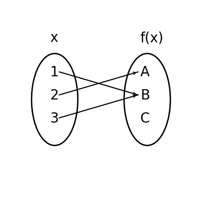
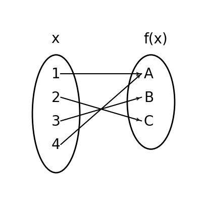

# AVP0776 — Single visual target

DynaMath:89 / DynaMath:90 · same type · Mathematical roles of symbols

## Shared or similar visual information

The uppercase letter A.

## Evidence locations

- Left image: A at the top element in the f(x) oval receiving an arrow from 2.
- Right image: A at the top element in the f(x) oval receiving arrows from 1 and 4.

## Mathematical meanings

Left image: A names an element of the output set of the mapping (the top element in the f(x) oval receiving an arrow from 2). Right image: A names an element of the output set of the mapping (the top element in the f(x) oval receiving arrows from 1 and 4).

## Same mathematical meanings

yes

## Rationales

In both images, A names an element of the output set of the mapping. The relevant locations are the top element in the f(x) oval receiving an arrow from 2 on the left and the top element in the f(x) oval receiving arrows from 1 and 4 on the right.

Only the selected target is annotated. AI visual-review draft; not independently double-annotated by humans.
