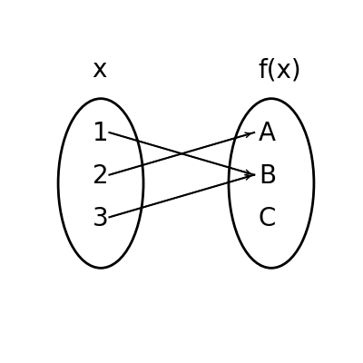
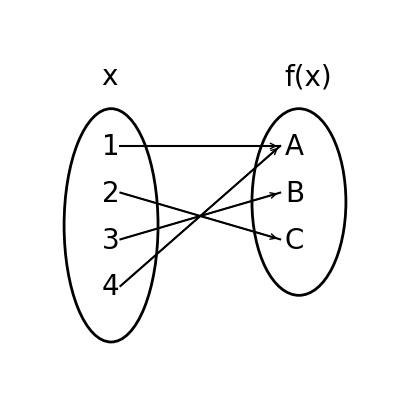

# AVP0776 — Single visual target

DynaMath:89 / DynaMath:90 · same type · Mathematical roles of symbols

## Shared or similar visual information

The letter A

## Evidence locations

- Left image: A at the top of the output oval, where the arrow from 2 ends
- Right image: A at the top of the output oval, with incoming arrows from 1 and 4

## Mathematical meanings

Left image: The symbol "A" names the output element reached by the indicated input arrows. Right image: The symbol "A" names the output element reached by the indicated input arrows.

## Same mathematical meanings

yes

## Rationales

The left occurrence is A at the top of the output oval, where the arrow from 2 ends. The right occurrence is A at the top of the output oval, with incoming arrows from 1 and 4. The placement in each image shows that the symbol names the output element reached by the indicated input arrows.

Only the selected target is annotated. AI visual-review draft; not independently double-annotated by humans.
