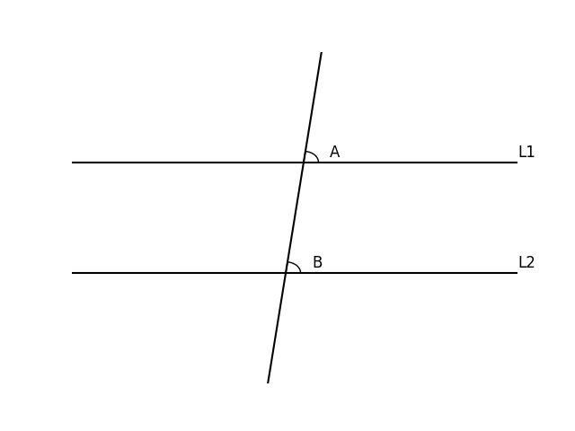
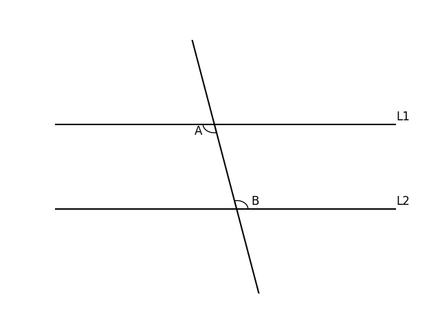

# AVP0777 — Single visual target

DynaMath:184 / DynaMath:182 · same type · Mathematical roles of symbols

## Shared or similar visual information

The letter B

## Evidence locations

- Left image: B beside the acute-angle arc on the lower parallel line
- Right image: B beside the arc above the lower parallel line

## Mathematical meanings

Left image: The symbol "B" names the angle singled out by the arc. Right image: The symbol "B" names the angle singled out by the arc.

## Same mathematical meanings

yes

## Rationales

The left occurrence is B beside the acute-angle arc on the lower parallel line. The right occurrence is B beside the arc above the lower parallel line. The placement in each image shows that the symbol names the angle singled out by the arc.

Only the selected target is annotated. AI visual-review draft; not independently double-annotated by humans.
