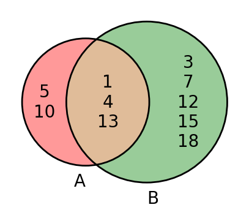
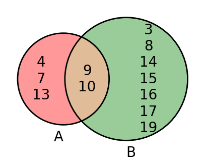

# AVP0778 — Single visual target

DynaMath:468 / DynaMath:473 · same type · Mathematical roles of symbols

## Shared or similar visual information

The letter B

## Evidence locations

- Left image: B below the green set circle
- Right image: B below the circle with 3 and 7 in its right-only part

## Mathematical meanings

Left image: The symbol "B" names the set represented by the indicated circle. Right image: The symbol "B" names the set represented by the indicated circle.

## Same mathematical meanings

yes

## Rationales

The left occurrence is B below the green set circle. The right occurrence is B below the circle with 3 and 7 in its right-only part. The placement in each image shows that the symbol names the set represented by the indicated circle.

Only the selected target is annotated. AI visual-review draft; not independently double-annotated by humans.
