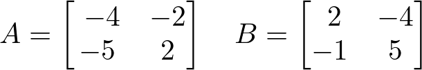
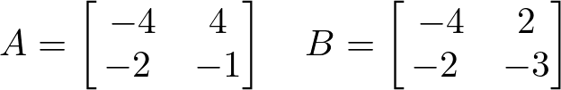

# AVP0779 — Single visual target

DynaMath:488 / DynaMath:475 · same type · Mathematical roles of symbols

## Shared or similar visual information

The letter B

## Evidence locations

- Left image: B before the second 2 by 2 array, whose first row is 2, -4
- Right image: B before the second bracketed array

## Mathematical meanings

Left image: The symbol "B" names the matrix whose entries follow in brackets. Right image: The symbol "B" names the matrix whose entries follow in brackets.

## Same mathematical meanings

yes

## Rationales

The left occurrence is B before the second 2 by 2 array, whose first row is 2, -4. The right occurrence is B before the second bracketed array. The placement in each image shows that the symbol names the matrix whose entries follow in brackets.

Only the selected target is annotated. AI visual-review draft; not independently double-annotated by humans.
