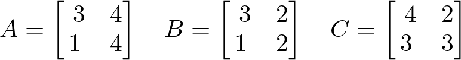
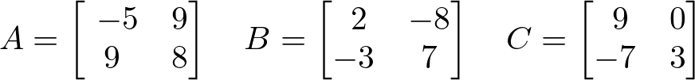

# AVP0780 — Single visual target

DynaMath:478 / DynaMath:491 · same type · Mathematical roles of symbols

## Shared or similar visual information

The letter C

## Evidence locations

- Left image: C before the rightmost 2 by 2 matrix
- Right image: C before the rightmost array, whose first row is 9, 0

## Mathematical meanings

Left image: The symbol "C" names the matrix whose entries follow in brackets. Right image: The symbol "C" names the matrix whose entries follow in brackets.

## Same mathematical meanings

yes

## Rationales

The left occurrence is C before the rightmost 2 by 2 matrix. The right occurrence is C before the rightmost array, whose first row is 9, 0. The placement in each image shows that the symbol names the matrix whose entries follow in brackets.

Only the selected target is annotated. AI visual-review draft; not independently double-annotated by humans.
