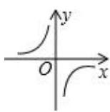

# AVP0781 — Single visual target

MV-MATH:963_1 / DynaMath:55 · different type · Mathematical roles of symbols

## Shared or similar visual information

The letter O

## Evidence locations

- Left image: O at the axes' intersection between the separated branches
- Right image: O beside the intersection of the coordinate axes through the circle

## Mathematical meanings

Left image: The symbol "O" marks the origin at the intersection of the coordinate axes. Right image: The symbol "O" marks the origin at the intersection of the coordinate axes.

## Same mathematical meanings

yes

## Rationales

The left occurrence is O at the axes' intersection between the separated branches. The right occurrence is O beside the intersection of the coordinate axes through the circle. The placement in each image shows that the symbol marks the origin at the intersection of the coordinate axes.

Only the selected target is annotated. AI visual-review draft; not independently double-annotated by humans.
