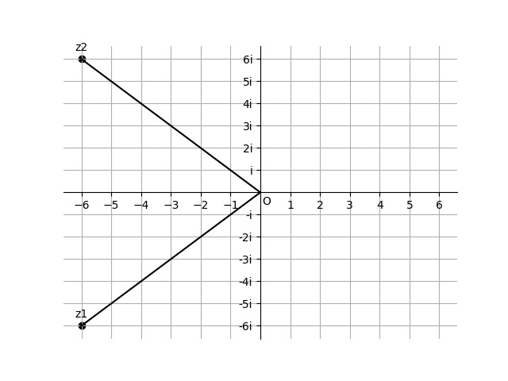
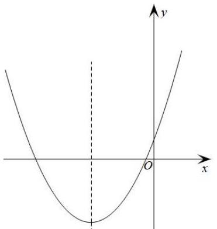

# AVP0782 — Single visual target

DynaMath:338 / MV-MATH:634_1 · different type · Mathematical roles of symbols

## Shared or similar visual information

The letter O

## Evidence locations

- Left image: O where the real and imaginary axes cross
- Right image: O at the crossing of the solid coordinate axes

## Mathematical meanings

Left image: The symbol "O" marks the origin at the intersection of the coordinate axes. Right image: The symbol "O" marks the origin at the intersection of the coordinate axes.

## Same mathematical meanings

yes

## Rationales

The left occurrence is O where the real and imaginary axes cross. The right occurrence is O at the crossing of the solid coordinate axes. The placement in each image shows that the symbol marks the origin at the intersection of the coordinate axes.

Only the selected target is annotated. AI visual-review draft; not independently double-annotated by humans.
