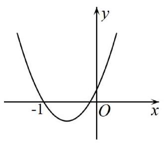
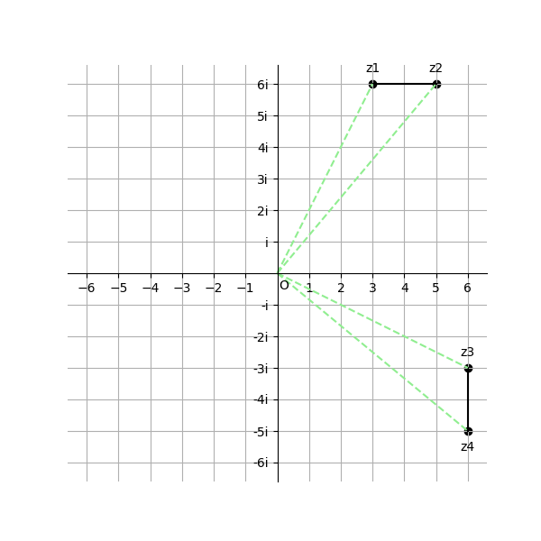

# AVP0783 — Single visual target

MV-MATH:85_1 / DynaMath:339 · different type · Mathematical roles of symbols

## Shared or similar visual information

The letter O

## Evidence locations

- Left image: O below and to the right of the coordinate axes' crossing
- Right image: O at the common start of the dotted rays on the complex plane

## Mathematical meanings

Left image: The symbol "O" marks the origin at the intersection of the coordinate axes. Right image: The symbol "O" marks the origin at the intersection of the coordinate axes.

## Same mathematical meanings

yes

## Rationales

The left occurrence is O below and to the right of the coordinate axes' crossing. The right occurrence is O at the common start of the dotted rays on the complex plane. The placement in each image shows that the symbol marks the origin at the intersection of the coordinate axes.

Only the selected target is annotated. AI visual-review draft; not independently double-annotated by humans.
