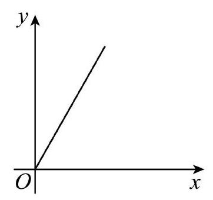
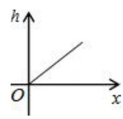

# AVP0784 — Single visual target

MV-MATH:1047_1 / MV-MATH:1063_1 · same type · Mathematical roles of symbols

## Shared or similar visual information

The letter O

## Evidence locations

- Left image: O just below the crossing of the x- and y-axes
- Right image: O at the meeting of the horizontal x and vertical h axes

## Mathematical meanings

Left image: The symbol "O" marks the origin at the intersection of the coordinate axes. Right image: The symbol "O" marks the origin at the intersection of the coordinate axes.

## Same mathematical meanings

yes

## Rationales

The left occurrence is O just below the crossing of the x- and y-axes. The right occurrence is O at the meeting of the horizontal x and vertical h axes. The placement in each image shows that the symbol marks the origin at the intersection of the coordinate axes.

Only the selected target is annotated. AI visual-review draft; not independently double-annotated by humans.
