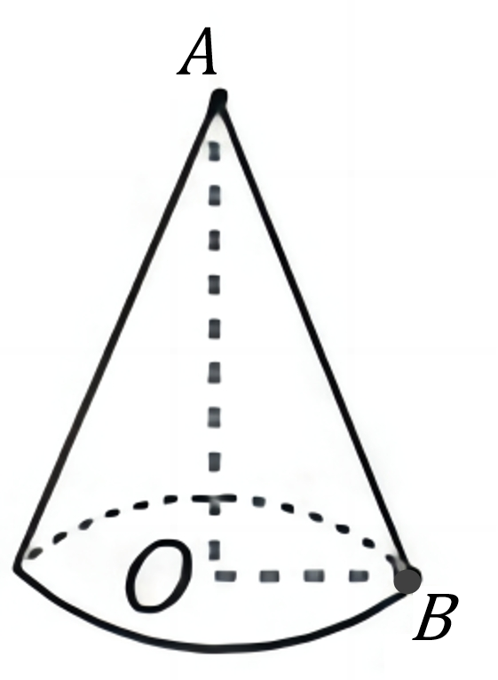
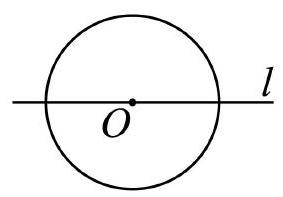

# AVP0785 — Single visual target

DynaMath:8 / MV-MATH:219_1 · different type · Mathematical roles of symbols

## Shared or similar visual information

The letter O

## Evidence locations

- Left image: O at the internal junction of the dashed height and base radius
- Right image: O beneath the center dot on horizontal line l

## Mathematical meanings

Left image: The symbol "O" marks the center of the indicated circle. Right image: The symbol "O" marks the center of the indicated circle.

## Same mathematical meanings

yes

## Rationales

The left occurrence is O at the internal junction of the dashed height and base radius. The right occurrence is O beneath the center dot on horizontal line l. The placement in each image shows that the symbol marks the center of the indicated circle.

Only the selected target is annotated. AI visual-review draft; not independently double-annotated by humans.
