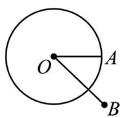
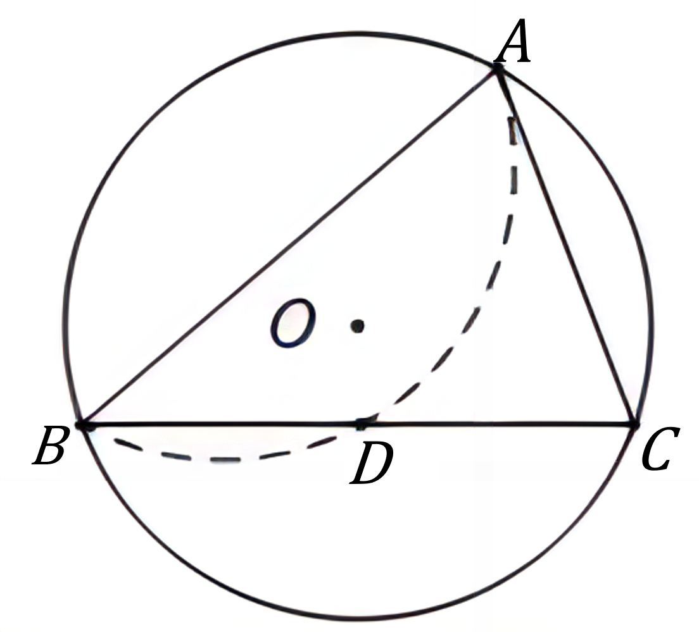

# AVP0786 — Single visual target

MV-MATH:210_1 / DynaMath:76 · same type · Mathematical roles of symbols

## Shared or similar visual information

The letter O

## Evidence locations

- Left image: O next to the interior point from which the radius OA extends
- Right image: O beside the black dot inside the large circle

## Mathematical meanings

Left image: The symbol "O" marks the center of the indicated circle. Right image: The symbol "O" marks the center of the indicated circle.

## Same mathematical meanings

yes

## Rationales

The left occurrence is O next to the interior point from which the radius OA extends. The right occurrence is O beside the black dot inside the large circle. The placement in each image shows that the symbol marks the center of the indicated circle.

Only the selected target is annotated. AI visual-review draft; not independently double-annotated by humans.
