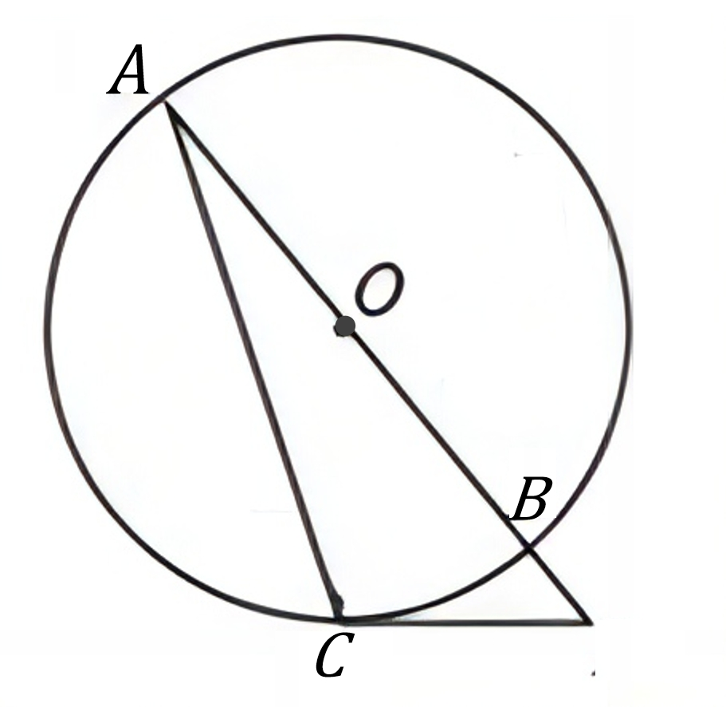
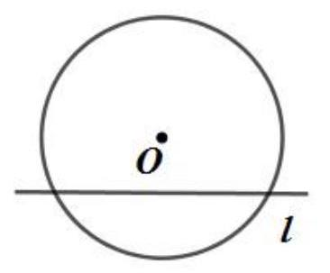

# AVP0787 — Single visual target

DynaMath:81 / MV-MATH:227_1 · same type · Mathematical roles of symbols

## Shared or similar visual information

The letter O

## Evidence locations

- Left image: O beside the black dot on the diameter through A and B
- Right image: O beneath the dot at the center, above the horizontal chord

## Mathematical meanings

Left image: The symbol "O" marks the center of the indicated circle. Right image: The symbol "O" marks the center of the indicated circle.

## Same mathematical meanings

yes

## Rationales

The left occurrence is O beside the black dot on the diameter through A and B. The right occurrence is O beneath the dot at the center, above the horizontal chord. The placement in each image shows that the symbol marks the center of the indicated circle.

Only the selected target is annotated. AI visual-review draft; not independently double-annotated by humans.
