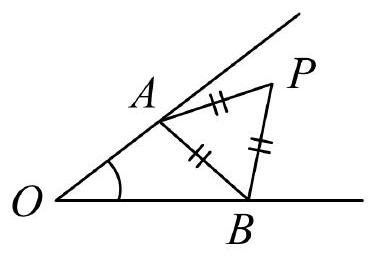
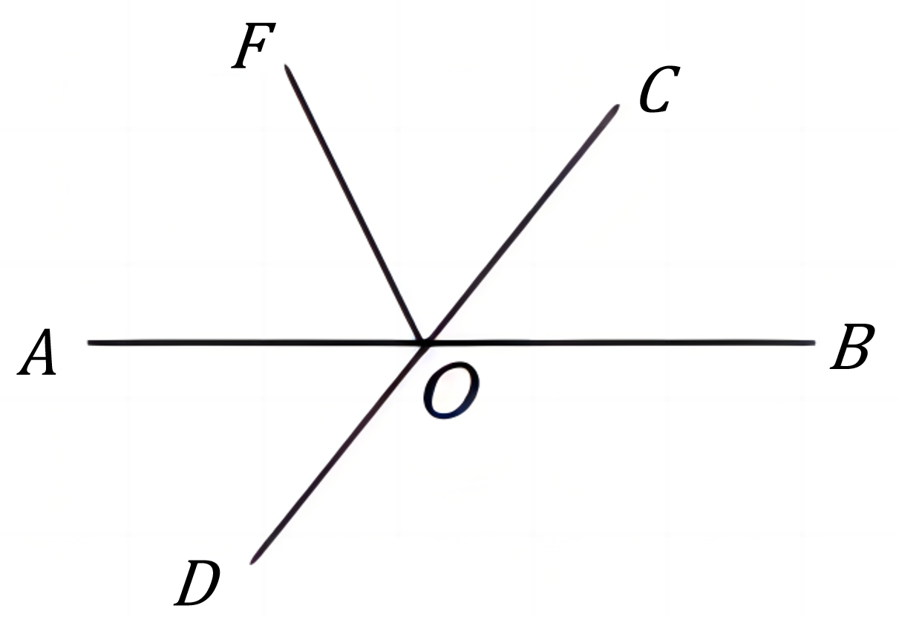

# AVP0788 — Single visual target

MV-MATH:563_1 / DynaMath:11 · same type · Mathematical roles of symbols

## Shared or similar visual information

The uppercase letter O.

## Evidence locations

- Left image: O at the common endpoint of the two rays at the marked angle.
- Right image: O at the common intersection of the horizontal and sloping lines.

## Mathematical meanings

Left image: O names a specific point in the diagram (the common endpoint of the two rays at the marked angle). Right image: O names a specific point in the diagram (the common intersection of the horizontal and sloping lines).

## Same mathematical meanings

yes

## Rationales

In both images, O names a specific point in the diagram. The relevant locations are the common endpoint of the two rays at the marked angle on the left and the common intersection of the horizontal and sloping lines on the right.

Only the selected target is annotated. AI visual-review draft; not independently double-annotated by humans.
