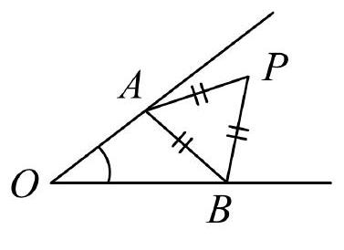
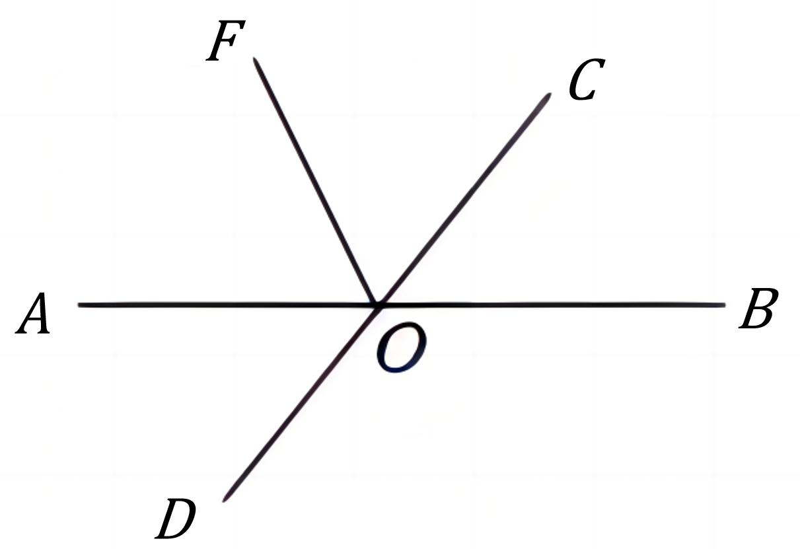

# AVP0788 — Single visual target

MV-MATH:563_1 / DynaMath:11 · same type · Mathematical roles of symbols

## Shared or similar visual information

The letter O

## Evidence locations

- Left image: O at the left endpoint of the two rays enclosing the small arc
- Right image: O where the horizontal line and oblique rays meet

## Mathematical meanings

Left image: The symbol "O" names the common point of the rays that form an angle. Right image: The symbol "O" names the common point of the rays that form an angle.

## Same mathematical meanings

yes

## Rationales

The left occurrence is O at the left endpoint of the two rays enclosing the small arc. The right occurrence is O where the horizontal line and oblique rays meet. The placement in each image shows that the symbol names the common point of the rays that form an angle.

Only the selected target is annotated. AI visual-review draft; not independently double-annotated by humans.
