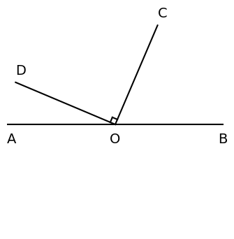
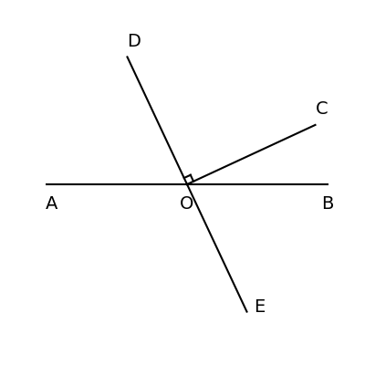

# AVP0789 — Single visual target

DynaMath:83 / DynaMath:197 · same type · Mathematical roles of symbols

## Shared or similar visual information

The letter O

## Evidence locations

- Left image: O at the common endpoint of the rays forming the marked right angle
- Right image: O at the crossing of AB and DE beside the angle marker

## Mathematical meanings

Left image: The symbol "O" names the common point of the rays that form an angle. Right image: The symbol "O" names the common point of the rays that form an angle.

## Same mathematical meanings

yes

## Rationales

The left occurrence is O at the common endpoint of the rays forming the marked right angle. The right occurrence is O at the crossing of AB and DE beside the angle marker. The placement in each image shows that the symbol names the common point of the rays that form an angle.

Only the selected target is annotated. AI visual-review draft; not independently double-annotated by humans.
