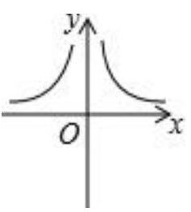

# AVP0790 — Single visual target

MV-MATH:996_1 / DynaMath:55 · different type · Mathematical roles of symbols

## Shared or similar visual information

The letter x

## Evidence locations

- Left image: x to the right of the horizontal arrow beneath the two branches
- Right image: x beside the arrow at the right end of the horizontal axis

## Mathematical meanings

Left image: The symbol "x" labels the indicated coordinate axis. Right image: The symbol "x" labels the indicated coordinate axis.

## Same mathematical meanings

yes

## Rationales

The left occurrence is x to the right of the horizontal arrow beneath the two branches. The right occurrence is x beside the arrow at the right end of the horizontal axis. The placement in each image shows that the symbol labels the indicated coordinate axis.

Only the selected target is annotated. AI visual-review draft; not independently double-annotated by humans.
